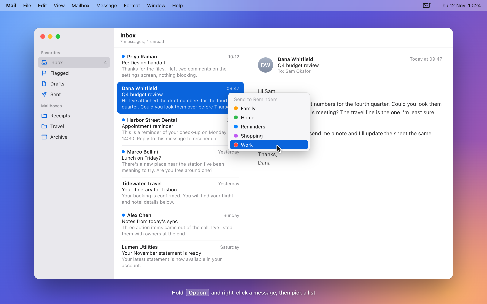

# MailRem

Send the message you have selected in Apple Mail to a Reminders list in one step.

MailRem is a small menu bar app for macOS. It does not depend on any other software.



*Illustration with sample messages.*

- **Option + right-click** a message in Mail: a menu with your Reminders lists opens next to the pointer. Pick a list and the message is added to it as a reminder.
- **Control-Option-R** in Mail: the same menu opens for the selected message; type the first letters of a list and press Return.
- **Menu bar icon:** the same lists are available from the MailRem menu at any time.

Each reminder gets the message subject as its title. Its note holds the sender and a link that opens the message in Mail.

macOS does not let apps add items to Mail's own right-click menu. That is why MailRem opens a menu of its own when you hold Option, instead of appearing inside Mail's menu.

## Requirements

- macOS 13 or later, Apple Silicon or Intel

## Install

### Download

1. Download `MailRem-<version>.dmg` from the [latest release](https://github.com/kogungor/mailrem/releases/latest).
2. Open the disk image and drag **MailRem** to **Applications**.
3. Open MailRem from Applications.

The app is signed and notarized by Apple, so it opens without a security warning.

### Homebrew

```bash
brew tap kogungor/mailrem https://github.com/kogungor/mailrem
brew trust kogungor/mailrem
brew install --cask mailrem
```

Recent versions of Homebrew only load casks from taps you have marked as trusted, which is what the second command does.

## Permissions

On first launch macOS asks for three permissions:

| Permission | Why |
|---|---|
| Accessibility | To notice Option + right-click in Mail and open the menu |
| Reminders | To read your lists and add reminders |
| Automation (Mail) | To read the subject, sender and link of the selected message |

The Mail prompt appears while Mail is running. If you did not see it, open Mail and bring it to the front once.

To change a permission later, open **System Settings > Privacy & Security** and look under **Accessibility**, **Reminders** or **Automation**.

## Privacy

MailRem works entirely on your Mac.

- It has no account, no analytics and no server of its own.
- From Mail it reads only the subject, sender and message ID of the messages you send to Reminders, at the moment you send them. It never reads message bodies or attachments.
- The Accessibility permission is used for one thing: noticing a right-click made with Option held down while Mail is the frontmost app. MailRem does not watch the keyboard and ignores clicks in other apps.
- Its only network request is the update check, which asks GitHub for the latest release of this repository. Nothing about you or your mail is sent. Switch off **Check for Updates Automatically** to stop it.

## Good to know

- The link in a reminder opens the message on a Mac whose Mail has that message. It may stop working if the message is deleted.
- Reminders sync through iCloud as usual, so they also appear on your iPhone and iPad. MailRem itself is for macOS only.
- The keyboard shortcut is fixed to Control-Option-R.

## Options

The MailRem menu in the menu bar has these switches:

- **Option + Right-Click Menu in Mail**
- **Control-Option-R in Mail**
- **Launch at Login**
- **Check for Updates Automatically**

## Updates

MailRem checks GitHub for a new release when it starts and every six hours. When one is available the menu bar icon turns orange and **Update to MailRem <version>** appears at the top of the menu. Choosing it downloads the new version, replaces the app and reopens it.

An update is only installed if it is signed by the same developer as the version you are running. You can also choose **Check for Updates…** at any time, or switch automatic checks off.

To install updates without asking, run:

```bash
defaults write com.kogungor.mailrem autoInstallUpdates -bool YES
```

## Uninstall

Quit MailRem from its menu and move it from Applications to the Trash.

## Building from source

Requires the Xcode command line tools.

```bash
scripts/build.sh      # builds and signs build/MailRem.app
scripts/package.sh    # builds dist/MailRem-<version>.dmg
```

`build.sh` signs with a "Developer ID Application" certificate when one is in the keychain and falls back to an ad-hoc signature otherwise. To notarize the disk image, store credentials once with `xcrun notarytool store-credentials mailrem-notary` and run `NOTARY_PROFILE=mailrem-notary scripts/package.sh`.

### Releasing

1. Set the new version in `Resources/Info.plist`.
2. Run `NOTARY_PROFILE=<profile> scripts/package.sh`.
3. Update `version` and `sha256` in `Casks/mailrem.rb` with the values the script prints.
4. Commit, tag `v<version>` and attach the disk image to a GitHub release. Installed copies find the update from the release tag and its `.dmg` asset.

### Layout

- `Sources/MailRem/`: the app (Swift, AppKit)
- `Resources/`: `Info.plist`, entitlements and the app icon
- `scripts/build.sh`, `scripts/package.sh`: build and packaging
- `scripts/make-icon.swift`: regenerates `Resources/AppIcon.icns`
- `Casks/mailrem.rb`: Homebrew cask
- `docs/`: the README illustration and the HTML it is rendered from

## License

MailRem is released under the [MIT License](LICENSE).
